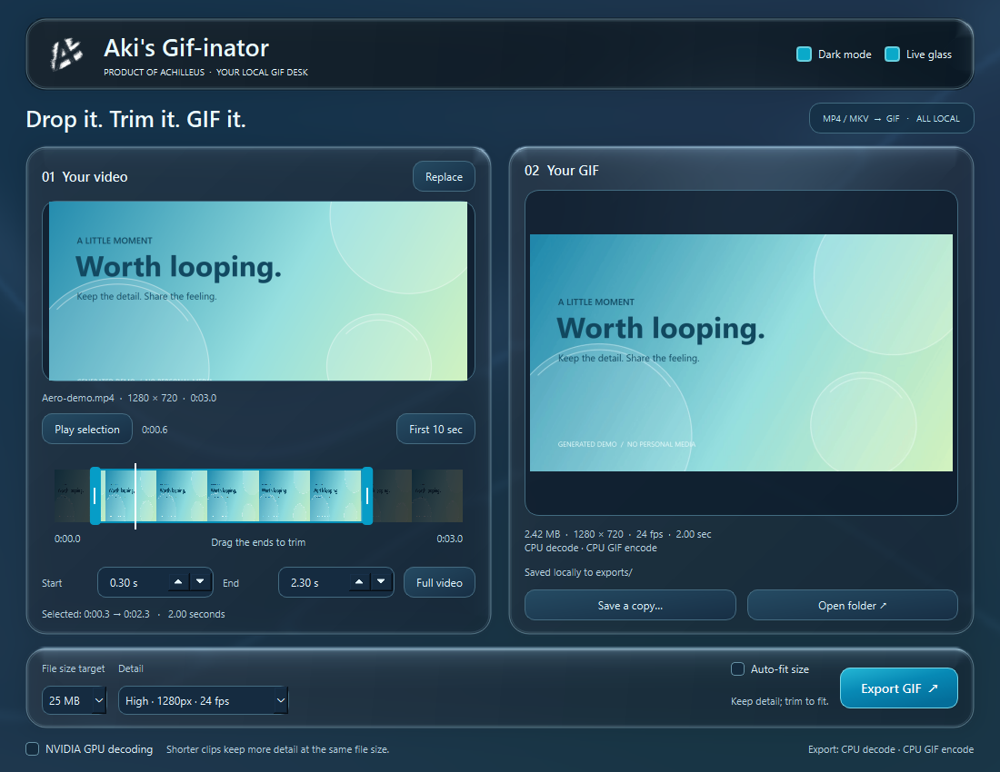

# Aki's Gif-inator

**[Product of Achilleus](https://linktr.ee/achilleus_)** — Created and maintained by [Achilleus (Achilleus-1)](https://github.com/Achilleus-1).

Drop a video, keep the moment, make a GIF. A native desktop app for MP4 and MKV,
with a Frutiger Aero desk, interactive liquid glass, a real trim timeline, and
optional NVIDIA hardware decoding. Files stay on your computer.

[](https://github.com/Achilleus-1/Akis-Gif-inator/actions/workflows/checks.yml)
[](LICENSE)
[](https://www.python.org/downloads/)


**[Download Windows installer](https://github.com/Achilleus-1/Akis-Gif-inator/releases/latest)** · [User guide](docs/USER_GUIDE.md) · [Troubleshooting](docs/TROUBLESHOOTING.md) · [Changelog](CHANGELOG.md)

## What you get

- Drag and drop MP4/MKV; export a looping GIF without uploading anything.
- Thumbnail timeline with two trim handles, preview seeking and exact times.
- Detail choices from 480px/15 fps to 1920px/30 fps, never upscaling the source.
- Custom palettes and smoother Sierra dithering in the higher detail presets.
- Optional size fitting, actual file-size checks, and a trim-to-fit suggestion.
- Optional NVIDIA NVDEC with automatic CPU fallback and truthful device/timing indicators.
- Remembered Dark mode with dark controls, timeline, previews and glass.
- Native OpenGL glass refraction, pointer reflections and click ripples. Still Aero fallback, with a Live glass switch and animation paused while inactive.
- Automatically saved unique exports, an animated preview and Save a copy.

## Install on Windows

1. Open [Releases](https://github.com/Achilleus-1/Akis-Gif-inator/releases/latest) and download `Akis-Gif-inator-1.2.0-windows-x64-setup.exe`.
2. Run Setup. It installs for your user account, creates a Start menu shortcut, and can add a desktop shortcut. No administrator account or manual Python commands are needed.
3. Launch **Aki's Gif-inator** from the shortcut. Uninstall through Windows Installed apps.

Windows 10/11 x64 is supported. Internet is required during installation: Setup
fetches a private Python 3.13.16 runtime and pinned Qt/PySide6 wheels from
Python.org and PyPI. It reuses FFmpeg/FFprobe on PATH, or downloads Gyan's
FFmpeg 9.0.2 essentials build if the download task is selected. Every downloaded
package is checked against a pinned publisher SHA-256 before extraction.
The runtime stays inside the app folder; system Python and PATH are unchanged.

Once installed, conversion and playback work offline. The default install folder
is `%LOCALAPPDATA%/Programs/Akis-Gif-inator`. GIFs go in its `exports/` folder;
uninstall preserves user exports. Download `SHA256SUMS.txt` to verify release
assets. The installer is currently unsigned; it does not bypass Windows security.

[Installation and dependency details](docs/DISTRIBUTION.md)

## Make a GIF

1. Drop an MP4 or MKV, or click Choose video.
2. Optionally drag the blue timeline handles to shorten it. Play selection checks your chosen range.
3. Pick detail and a size target, then click Export GIF.

The full video is selected initially. Outputs go in `exports/` beside the app;
originals are never edited. Audio and separate subtitle tracks are omitted.
Text already visible in the video remains part of the frames.

## Quality and sharing

| Detail | Maximum longest edge | Maximum frame rate |
| --- | --- | --- |
| Compact | 480px | 15 fps |
| Balanced | 720px | 15 fps |
| Smooth | 720px | 20 fps |
| Sharp | 960px | 15 fps |
| Extra detail | 960px | 20 fps |
| High (default) | 1280px | 24 fps |
| Much higher | 1920px | 30 fps |

Smooth favors motion at 720px; Sharp favors finer detail at a lower frame rate.
Both use Sierra dithering, like Extra detail and the higher presets.

The default is High, a 25 MB target, and Auto-fit size off. Keep fitting off to
preserve readable detail; shorten the clip when it is too large. Turn it on to
allow lower frame rate, dimensions and colors until the target is met or the
minimum is reached. Selected duration is never silently shortened.

Targets are 4, 8, 10, 25, 50 and 100 MB. They are budgets, not guarantees that
any service accepts the file. GIF uses at most 256 colors per palette and
hundredths-of-a-second frame delays. Short clips usually retain more detail at a
small size. [Full behavior and limits](docs/USER_GUIDE.md#quality-and-size).

<details>
<summary>Dark glass preview</summary>



</details>

## CPU and GPU

NVIDIA GPU decoding is optional and off by default. It tries CUDA device 0,
requires a working NVIDIA driver, and falls back to CPU if unsupported. GIF
encoding, palette generation and filters remain on CPU. The result displays
what was actually used and total export time.

The RTX 5070 Ti was verified with H.264 and 10-bit HEVC. GPU mode was about 8%
slower on the short synthetic clips measured locally; your own sources may
benefit differently. [Benchmark and method](GPU-BENCHMARK.md).

The Live glass switch controls only the decorative interface shader. It is
independent of NVIDIA video decoding. [Architecture](docs/ARCHITECTURE.md).

## Local by design

No server, browser, telemetry, account login or network request is used by the
app. Source videos are read directly; intermediate palettes/GIFs use temporary
storage and are removed on completion or cancellation. Full local paths are
shown in the running app to help locate exports, but never sent anywhere.
Pointer positions are transient and never saved. Your theme preference is saved locally. [Privacy](docs/PRIVACY.md).

## Development

End users should use the installer above. To run the source, install Python
3.12+ and FFmpeg/FFprobe, then create a local environment:

```powershell
python -m venv .venv
.\.venv\Scripts\python.exe -m pip install -r requirements.txt
.\.venv\Scripts\python.exe app.py
```

The source tree contains the native app modules, `assets/`, `docs/`, `tests/`,
`tools/`, `installer/` and `.github/workflows/`. Dependencies and release binaries
are excluded from Git. `requirements.txt` pins developer packages;
`installer/dependencies.json` pins installation URLs and hashes.

```powershell
.\.venv\Scripts\python.exe -m unittest discover -s tests -v
.\.venv\Scripts\python.exe tools/package_release.py
.\.venv\Scripts\python.exe build.py
```

For an installer, install Inno Setup 6.6+ and run `python tools/build_installer.py`.
The release workflow builds Setup, tests installation/export/uninstall, creates
checksums, and publishes versioned assets on matching `v*` tags.

For personal single-file builds, `build.py` uses FFmpeg/FFprobe on PATH, or accepts `--ffmpeg-dir` pointing at a
local binary folder. It creates **Akis-Gif-inator.exe**, including its native
interface, runtime, FFmpeg and branding. Initial extraction can take a few
seconds. FFmpeg is not downloaded by the app or included in the Git repository.

CI checks source privacy and packaging on Windows and Ubuntu. Tests use generated
videos and temporary folders; NVIDIA checks skip when supported hardware is
unavailable. Actual shader rendering is checked separately from headless tests.

[Contributing](CONTRIBUTING.md) · [Security](SECURITY.md) · [Code of conduct](CODE_OF_CONDUCT.md) · [Distribution requirements](docs/DISTRIBUTION.md)

## License and identity

Original code is **GPL-3.0-or-later**, Copyright (c) 2026 Achilleus. The adapted
MIT glass formulas retain their notice. Dependencies keep their own licenses;
see [third-party notices](THIRD-PARTY-NOTICES.txt). Achilleus branding identifies
this project; the code license does not grant trademark rights.

This is independent of Apple, NVIDIA, Qt and FFmpeg. The liquid-glass appearance
is an original native adaptation of the companion scrobbler's open-source
visual effects; no proprietary Apple shader or artwork is included.

Official releases contain a **Windows setup EXE, source ZIP and checksums**.
Setup contains this project's source and the Inno Setup engine; Python, Qt and
FFmpeg are obtained by the installer directly from their publishers. Their
licenses/notices are retained in the installed runtime. FFmpeg is acknowledged
and linked as an independent dependency, not checked into Git or rehosted inside
our installer. A private all-in-one PyInstaller build is a different artifact
and still needs its own dependency distribution review before redistribution.
[Distribution details](docs/DISTRIBUTION.md).
