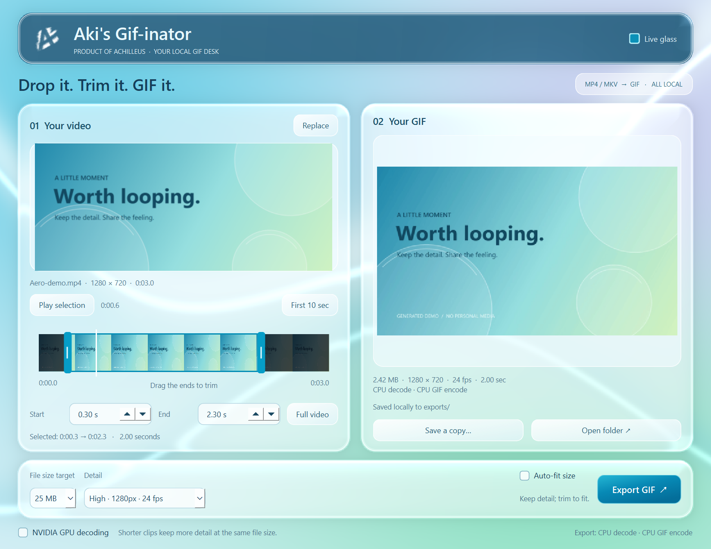

# Aki's Gif-inator

**[Product of Achilleus](https://linktr.ee/achilleus_)** — Created and maintained by [Achilleus (Achilleus-1)](https://github.com/Achilleus-1).

Drop a video, keep the moment, make a GIF. A native desktop app for MP4 and MKV,
with a Frutiger Aero desk, interactive liquid glass, a real trim timeline, and
optional NVIDIA hardware decoding. Files stay on your computer.

[](https://github.com/Achilleus-1/Akis-Gif-inator/actions/workflows/checks.yml)
[](LICENSE)
[](https://www.python.org/downloads/)



**[Source release 1.0.0](https://github.com/Achilleus-1/Akis-Gif-inator/releases/tag/v1.0.0)** · [User guide](docs/USER_GUIDE.md) · [Troubleshooting](docs/TROUBLESHOOTING.md) · [Changelog](CHANGELOG.md)

## What you get

- Drag and drop MP4/MKV; export a looping GIF without uploading anything.
- Thumbnail timeline with two trim handles, preview seeking and exact times.
- Detail choices from 480px/15 fps to 1920px/30 fps, never upscaling the source.
- Custom palettes and smoother Sierra dithering in the higher detail presets.
- Optional size fitting, actual file-size checks, and a trim-to-fit suggestion.
- Optional NVIDIA NVDEC with automatic CPU fallback and truthful device/timing indicators.
- Native OpenGL glass refraction, pointer reflections and click ripples. Still Aero fallback, with a Live glass switch and animation paused while inactive.
- Automatically saved unique exports, an animated preview and Save a copy.

## Get started

**The public release is a source ZIP, not a standalone executable.** It requires
Python 3.12 or newer, the pinned packages, and FFmpeg/FFprobe on PATH. Windows
10/11 x64 is the primary target. Local builds can bundle everything into one EXE.

```powershell
python -m venv .venv
.\.venv\Scripts\python.exe -m pip install -r requirements.txt
.\.venv\Scripts\python.exe app.py
```

With a configured environment, double-click **Start Akis Gif-inator.cmd**.
It launches the self-contained EXE if present, otherwise the local environment.

1. Drop an MP4 or MKV, or click Choose video.
2. Optionally drag the blue timeline handles to shorten it. Play selection checks your chosen range.
3. Pick detail and a size target, then click Export GIF.

The full video is selected initially. Outputs go in `exports/` beside the app;
originals are never edited. Audio and separate subtitle tracks are omitted.
Text already visible in the video remains part of the frames.

## Quality and sharing

| Detail | Maximum longest edge | Maximum frame rate |
| --- | --- | --- |
| Compact | 480px | 15 fps |
| Balanced | 720px | 15 fps |
| Extra detail | 960px | 20 fps |
| High (default) | 1280px | 24 fps |
| Much higher | 1920px | 30 fps |

The default is High, a 25 MB target, and Auto-fit size off. Keep fitting off to
preserve readable detail; shorten the clip when it is too large. Turn it on to
allow lower frame rate, dimensions and colors until the target is met or the
minimum is reached. Selected duration is never silently shortened.

Targets are 4, 8, 10, 25, 50 and 100 MB. They are budgets, not guarantees that
any service accepts the file. GIF uses at most 256 colors per palette and
hundredths-of-a-second frame delays. Short clips usually retain more detail at a
small size. [Full behavior and limits](docs/USER_GUIDE.md#quality-and-size).

## CPU and GPU

NVIDIA GPU decoding is optional and off by default. It tries CUDA device 0,
requires a working NVIDIA driver, and falls back to CPU if unsupported. GIF
encoding, palette generation and filters remain on CPU. The result displays
what was actually used and total export time.

The RTX 5070 Ti was verified with H.264 and 10-bit HEVC. GPU mode was about 8%
slower on the short synthetic clips measured locally; your own sources may
benefit differently. [Benchmark and method](GPU-BENCHMARK.md).

The Live glass switch controls only the decorative interface shader. It is
independent of NVIDIA video decoding. [Architecture](docs/ARCHITECTURE.md).

## Local by design

No server, browser, telemetry, account login or network request is used by the
app. Source videos are read directly; intermediate palettes/GIFs use temporary
storage and are removed on completion or cancellation. Full local paths are
shown in the running app to help locate exports, but never sent anywhere.
Pointer positions are transient and never saved. [Privacy](docs/PRIVACY.md).

## Development and local standalone build

```powershell
.\.venv\Scripts\python.exe -m unittest discover -s tests -v
.\.venv\Scripts\python.exe tools/package_release.py
.\.venv\Scripts\python.exe build.py
```

The builder uses FFmpeg/FFprobe on PATH, or accepts `--ffmpeg-dir` pointing at a
local binary folder. It creates **Akis-Gif-inator.exe**, including its native
interface, runtime, FFmpeg and branding. Initial extraction can take a few
seconds. FFmpeg is not downloaded by the app or included in the Git repository.

CI checks source privacy and packaging on Windows and Ubuntu. Tests use generated
videos and temporary folders; NVIDIA checks skip when supported hardware is
unavailable. Actual shader rendering is checked separately from headless tests.

[Contributing](CONTRIBUTING.md) · [Security](SECURITY.md) · [Code of conduct](CODE_OF_CONDUCT.md) · [Distribution requirements](docs/DISTRIBUTION.md)

## License and identity

Original code is **GPL-3.0-or-later**, Copyright (c) 2026 Achilleus. The adapted
MIT glass formulas retain their notice. Dependencies keep their own licenses;
see [third-party notices](THIRD-PARTY-NOTICES.txt). Achilleus branding identifies
this project; the code license does not grant trademark rights.

This is independent of Apple, NVIDIA, Qt and FFmpeg. The liquid-glass appearance
is an original native adaptation of the companion scrobbler's open-source
visual effects; no proprietary Apple shader or artwork is included.

The public 1.0.0 package contains source only. Do not redistribute a locally
built EXE until its complete dependency notices and corresponding-source
requirements have been met. A code license and source links alone do not
complete a binary distribution audit. [Details](docs/DISTRIBUTION.md).
